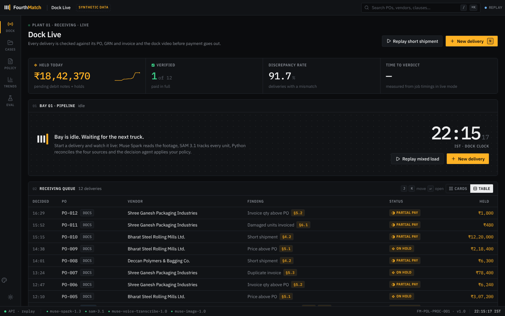
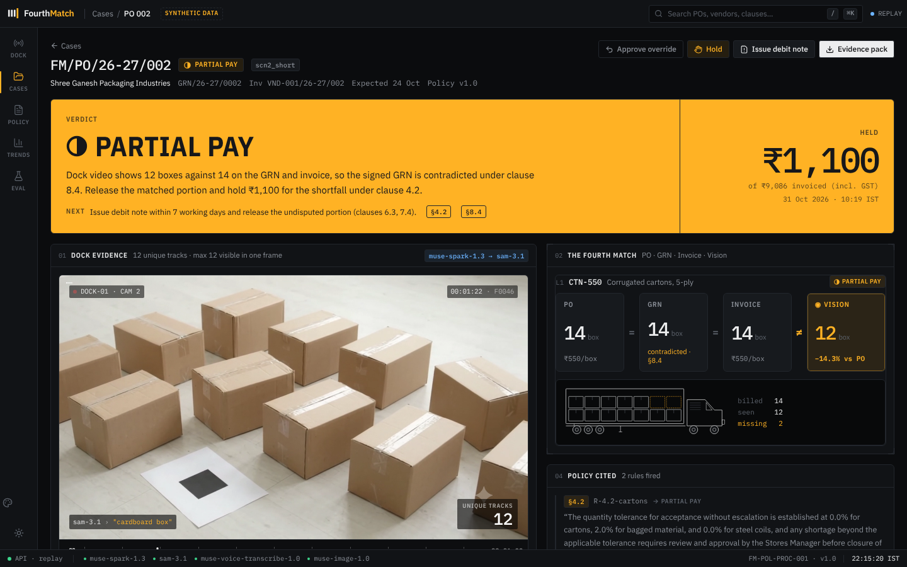
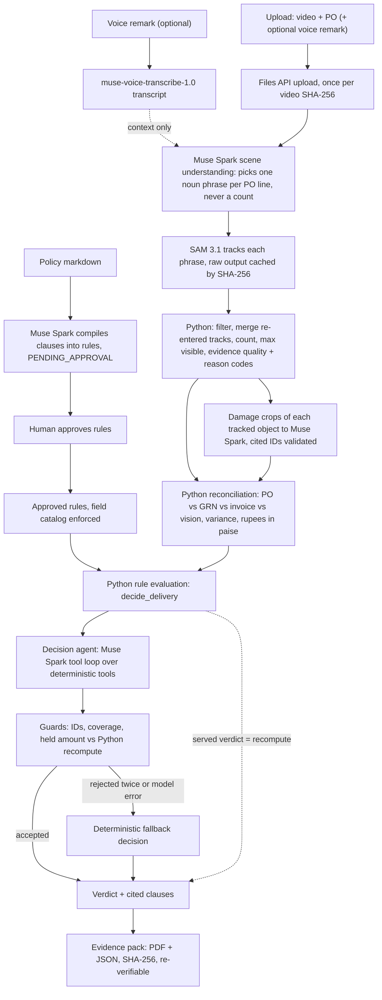
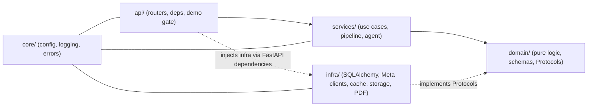
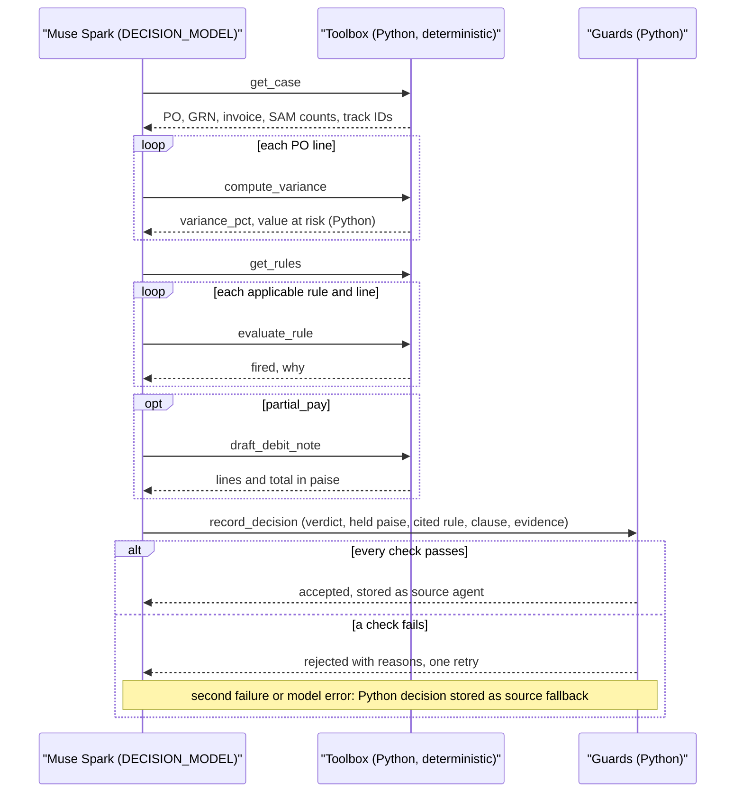
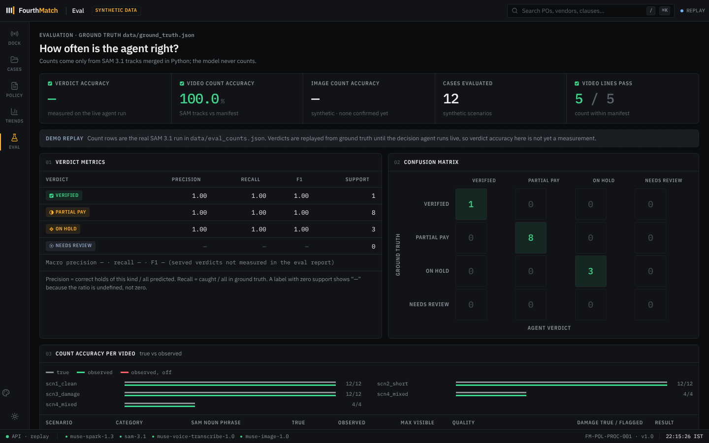
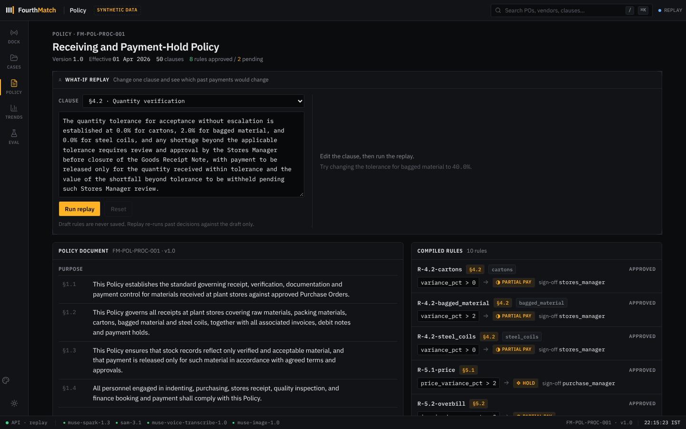

# FourthMatch

**Companies pay for goods nobody verified. FourthMatch makes the delivery itself the fourth match.**

Procurement runs on a three-way match: the purchase order (PO), the goods receipt note (GRN) and the
vendor invoice must agree before payment. All three are documents, and a signed GRN is only as good
as the storekeeper's count. FourthMatch adds a fourth source that is not a document: the receiving-dock
video. When what the camera shows contradicts what the paperwork says, the agent holds or reduces the
payment and cites the clause of the company's own receiving policy that justifies it.

Meta Global AI Hackathon entry, built solo between Oct 30 and Nov 4, 2026. All data is synthetic.

| | |
|---|---|
| Live demo | `<LIVE_DEMO_URL>` (placeholder, filled in after deploy; see [DEPLOY.md](DEPLOY.md)). Seeded cases replay without a login. Live uploads need a passcode, supplied to judges in the submission notes. |
| Demo video | `<DEMO_VIDEO_URL>` (placeholder) |
| Docs | [Architecture](docs/ARCHITECTURE.md) · [Model API notes](docs/MODEL_NOTES.md) · [Cases](docs/CASES.md) · [Evaluation findings](docs/EVAL.md) · [Deploy](DEPLOY.md) · [Handoff](docs/HANDOFF.md) |



## The problem

Take purchase order `FM/PO/26-27/002` from the seeded data (scenario `scn2_short`). Shree Ganesh
Packaging Industries is to deliver **14** corrugated cartons (SKU `CTN-5PLY-24`) at ₹550 each, so the
line is worth **₹7,700** before GST. The storekeeper signs the GRN for 14. The vendor invoices 14,
₹9,086 with 18% GST. Every document agrees, so a three-way match passes and the invoice is paid.

The dock video shows **12** cartons. Two never arrived, and the company pays ₹1,100 for them. No
document in the chain can reveal that, because all three were written by people who were not
counting against an independent record.

At one carton line this is small. The same seed set has a steel-coil purchase (`FM/PO/26-27/010`,
Bharat Steel Rolling Mills, 20 coils ordered) where a short shipment beyond tolerance puts
₹12,20,000 on the line, and the 12 seeded cases carry ₹18,42,370 in total at risk. Receiving fraud and
honest miscounts both land in the gap between "signed" and "seen", and nobody audits that gap at
invoice volume.

## How it works

A receiving-dock video is uploaded against a PO. Muse Spark reads the footage and chooses what to look
for, SAM 3.1 segments and tracks every object, and plain Python merges the tracks into a count and
decides whether the evidence is good enough to trust. Python then reconciles that count with the PO,
GRN and invoice under rules compiled from the company's receiving policy, a tool-calling decision agent
explains the outcome with cited clauses and track IDs, and the result is sealed into a
SHA-256-hashed, re-verifiable evidence pack.

For `scn2_short` the served verdict is `partial_pay`: SAM counts 12 tracks, the PO, GRN and invoice
say 14, clause 4.2 (tolerance on cartons is 0.0%) fires, ₹1,100 is held, and the undisputed portion
is released.



## Architecture

### Perception and decision pipeline



### Backend layers



`domain/` imports nothing from `infra`, FastAPI or SQLAlchemy. That is enforced by an AST scan in
`backend/tests/test_architecture.py`, not by convention.

### Decision agent tool loop



## Design decisions and why

Each decision is stated with its reason and the cost we accepted. The claims below are the ones the
code enforces; file paths point at where.

| # | Decision | Why | Trade-off |
|---|---|---|---|
| 1 | **Counts come only from SAM tracks, never from an LLM.** `domain/counting.py` counts distinct merged tracks; Spark's scene output is validated to be qualitative. | Language models estimate counts and drift between runs. A track is an object with an ID and frames: a count you can audit and a frame you can show. | SAM misses (heavy occlusion, a bad noun phrase) become count errors. We answer with decision 4 instead of letting a model guess. |
| 2 | **The LLM never does arithmetic.** Variance, held amount, value at risk and rupee totals are Python (`domain/decision.py`, `domain/money.py`). The agent receives them from tools, and the guard rejects any `amount_held_paise` that differs from the Python recompute (`domain/agent_logic.py`). | An invoice dispute needs a number that is right, not plausible. | The agent can only narrate and select; it cannot find a better number than the code. That is intended. |
| 3 | **Spark picks the noun phrase, SAM segments.** `services/perception.py` stage B asks Spark for one short visual phrase per PO line ("cardboard box") and forbids counts; SAM 3.1 is prompted with that phrase. A generic-noun second run catches a phrase that is too narrow (`apply_phrase_coverage`). | It uses each model for what it is built for. SAM 3.1 takes a short noun phrase as its prompt; a vision-language model is good at reading a scene and PO line and choosing that phrase. | Two model hops per line and a second SAM run for coverage, in exchange for not hand-tuning prompts per product. Phrase choice is cached so tuning cannot silently change it. |
| 4 | **Evidence quality is decided in Python with reason codes; weak evidence goes to `human_review`, never approve.** `count_line` returns `reliable` or `insufficient` with codes such as `short_track_ratio_high`, `merge_ratio_high`, `count_below_max_visible`, `phrase_coverage`, `no_tracks`. An insufficient line forces `human_review` in `decide_delivery`, and the agent guard overrides an `approve` on such a case. | The costly error here is paying on a video the system could not read. Thresholds live in config, so the reasons are inspectable and tunable. | More cases go to a person. We prefer that to a false approve. |
| 5 | **Policy is compiled into rules, gated by human approval, against a field catalog.** `services/policy_compiler.py` turns each numbered clause into rules saved as `PENDING_APPROVAL`; `domain/rules.py` `FIELD_CATALOG` is the only set of fields a rule may reference. A clause that needs anything else is flagged `ambiguity`, not guessed, and invalid rules get one validator-feedback retry. | Finance owns the policy, not the model. A compiled rule is a reviewable artifact with its verbatim source text and clause number. | An approval step before anything is enforced. `docs/EVAL.md` records what the compiler gets wrong (10/12 cases vs 12/12 with reference rules) rather than hiding it. |
| 6 | **Every ID a model cites is validated in Python.** Damage verdicts must cite a track and frame that were in the input; remark claims must name a real PO category; the agent's `track:<id>`, `frame:<n>`, `rule_id`, `po_line_id` are checked against the case facts. | A hallucinated ID in an evidence pack is worse than no citation. One bad ID rejects the output. | Occasional rejections and retries. They show up in `model_calls` and as fallback reasons. |
| 7 | **The agent uses deterministic tools; a fallback exists; the served verdict is the Python recompute.** The agent calls `get_case`, `compute_variance`, `get_rules`, `evaluate_rule`, `draft_debit_note`, then `record_decision`. Guards require coverage (every line and applicable rule was evaluated). Two rejected attempts, a turn cap or any model error store a deterministic decision with `source = "fallback"`. Case pages always serve `decide_delivery` output; the stored agent decision is attached with a `stale` flag. | The agent adds explanation and an auditable trace, not authority. The Cases screen and the policy what-if simulator can never disagree, and a model outage cannot block a payment decision. | The agent is not the decider of record. If it and the code disagree, the code wins and the disagreement is visible. |
| 8 | **Files API uploads and raw SAM output are cached by SHA-256.** `infra/cache.py`, `infra/meta/sam.py`; Spark calls cache on (video hash, inputs, model, prompt version). | SAM video runs are the slow, expensive step. Re-running parsing, merging or the eval must never re-call SAM, and cached raw output makes results reproducible. | A prompt-version string must be bumped when a prompt changes, or a stale cache is served. |
| 9 | **Evidence packs are hashed and re-verifiable.** `services/evidence.py`: the pack hash is the SHA-256 of the exact `evidence_pack.json` bytes (the PDF footer prints it); a manifest hashes every file, and `GET /api/evidence/{sha256}/verify` re-hashes them all. | A hold must survive a vendor dispute and an audit: the packet can prove it has not been edited. | Hashing proves integrity, not authorship. There is no signature or trusted timestamp. |
| 10 | **Job state is persisted, and SSE streams only stored rows.** `jobs` and `job_events` are written in the same transaction as each transition; `/api/deliveries/{id}/events` polls `job_events` by `seq`. | Progress can be replayed after a reload and is never invented by the UI. A reconnect resumes with `after_seq`. | Polling the table (0.5 s) instead of an in-memory pub/sub. Fine at this scale. |
| 11 | **The voice remark is context, not evidence.** `infra/meta/asr.py` transcribes it; `domain/remark.py` compares extracted claims with the observed counts and reports `supported / not_supported / unverifiable`. It never changes a count, a damage flag or a verdict. | A spoken claim is exactly what the video exists to check. It is useful as a cross-check ("Remark not supported by video"), dangerous as an input. | The remark cannot rescue a short delivery, by design. |
| 12 | **Synthetic Muse Image scenes are for evaluation only, never evidence.** `scripts/gen_eval_images.py` generates stills with prompted counts; `true_count` stays null until a human confirms it, and only confirmed images are scored. | Generated pictures give a wider counting test than four videos, but the generator's prompted count is not ground truth. | It is a SAM-counting benchmark on synthetic images, not a real-world accuracy claim. |
| 13 | **Ground truth lives only in `samples/scenarios/manifest.json`.** Seeds, the eval and the tests read counts and expected values from it. | One answer key means the eval cannot drift into agreeing with itself. | Adding a scenario means editing the manifest, then regenerating. |
| 14 | **Layered architecture with Protocols.** `api -> services -> domain <- infra`; `domain/protocols.py` defines repositories, `ModelClient`, `Transcriber`, `FileStore`, `CacheStore`; infra implements them and is injected through FastAPI dependencies. | Pure logic (counting, variance, rules) is unit-tested with fixture JSON and no model calls; the agent is tested against a fake model client. | More files and Pydantic contracts at each boundary than a single-module prototype. |
| 15 | **SQLite now, Postgres by changing `DATABASE_URL`.** SQLAlchemy 2.0 ORM, WAL mode so SSE can poll while the pipeline writes. | Zero-ops for a demo and a single instance. | One writer at a time. Postgres is untested here; the swap is designed for, not exercised. |
| 16 | **One Lightsail VM, no containers.** Caddy -> one uvicorn worker under systemd, which also serves the built SPA (`deploy/`, [DEPLOY.md](DEPLOY.md)). | A demo needs one cheap box (about $5-10/month), not an orchestrator. One process keeps SQLite, the pipeline semaphore and the rate limiter coherent. | No horizontal scale and no zero-downtime deploys. Delete it after judging. |
| 17 | **`DEMO_MODE` passcode and rate limit protect API credits.** `api/deps_demo.py` and `domain/rate_limit.py`: model-calling and write routes need `X-Demo-Passcode` (constant-time compare; empty server passcode disables live use) and uploads are capped per rolling hour (default 10, then 429). Replay of seeded cases stays open. | A public URL with a paid key behind it needs a gate. | The limiter is in-process, so it only holds with a single worker (see Limitations). |
| 18 | **Model IDs come only from `.env`.** `core/config.py` is the single place; a test fails if a model-ID literal appears under `backend/app/`, and `MetaModelClient` refuses a model that did not come from `ModelConfig`. | Models change; swapping one is a config edit with no code change. | A misconfigured `.env` fails at startup with the missing variable named. |
| 19 | **Responses API only, with stateless replay in the agent loop.** Every call uses `client.responses.create`, structured output with `strict` JSON schema, `include=["reasoning.encrypted_content"]` on the tool loop and no `previous_response_id`. | Video input works only on Responses on this API, and `docs/MODEL_NOTES.md` records the shapes that were verified live. | The loop replays prior output items each turn, so context grows with tool calls (capped by `max_agent_turns`). |

## Meta models used

Every model ID is read from `.env`; the IDs below are the values in `.env.example`.

| Model ID | Env var | Where | What it does |
|---|---|---|---|
| `muse-spark-1.3` | `PERCEPTION_MODEL` | `backend/app/services/perception.py` | Reads the dock video (`input_video` by Files API `file_id`) and picks one noun phrase per PO line plus scene facts. Inspects per-object crops for damage. Writes the one-line "footage needed" hint when evidence is weak. |
| `muse-spark-1.3` | `DECISION_MODEL` | `backend/app/services/decision_agent.py`, `backend/app/infra/meta/client.py` (`call_tool_turn`) | Tool-calling payment-decision agent, reasoning effort high. |
| `muse-spark-1.3` | `COMPILER_MODEL` | `backend/app/services/policy_compiler.py` | Compiles each numbered policy clause into structured rules; detects conflicts between rules. |
| `sam-3.1` | `SEG_MODEL` | `backend/app/infra/meta/sam.py` | Segments and tracks the phrase across the video via the official `meta-sam-parser`; the only source of counts. |
| `muse-spark-1.3-contributor` | `BULK_MODEL` | `backend/app/services/perception.py` (remark claim extraction), `scripts/generate_policy.py` | Cheaper model for text work: extracting claims from a transcript, and rewriting the synthetic policy prose. |
| `muse-voice-transcribe-1.0` | `VOICE_MODEL` | `backend/app/infra/meta/asr.py` | Transcribes the storekeeper's voice remark over `POST /v1/asr/transcribe`. Audio never goes to Spark. |
| `muse-image-1.0` | `IMAGE_MODEL` | `scripts/gen_eval_images.py` | Generates synthetic dock stills with prompted counts for the evaluation set. Never evidence. |
| `muse-wonder-1.0` | `WONDER_MODEL` | `scripts/smoke_models.py` | Present on the key and checked by the smoke test. It is not called by the application pipeline. |

The model layer was verified live against the Meta Model API with `scripts/smoke_models.py` (7 checks:
model list, strict JSON, tool loop, SAM image, SAM video, ASR, image generation). Verified request and
response shapes, and the gotchas we hit, are in [docs/MODEL_NOTES.md](docs/MODEL_NOTES.md).

## Evaluation

Numbers below are copied from `data/eval_counts.json` and `data/eval_results.json`, produced by
`scripts/eval_counts.py` and `scripts/run_eval.py`. Ground truth is `samples/scenarios/manifest.json`.
Anything not yet measured says so instead of showing a number.

| Metric | Result | Source |
|---|---|---|
| Video count accuracy (SAM tracks vs manifest) | **5 / 5 lines exact (100%)**, mean absolute error 0.0 | `eval_results.json` `videos.count_summary` |
| Damage detection (flagged vs manifest) | **5 / 5 lines exact (100%)**, 1 damaged carton found in `scn3_damage`, none flagged elsewhere | `eval_results.json` `videos.damage_summary` |
| Evidence quality on those lines | 5 / 5 `reliable` | `eval_counts.json` |
| Synthetic image count accuracy | pending: run `scripts/gen_eval_images.py`, confirm counts with `scripts/confirm_eval_images.py`, then `scripts/run_eval.py` | `eval_results.json` `images` (0 images) |
| Served verdict accuracy | pending: needs approved policy rules in the database, then `scripts/run_eval.py` | `eval_results.json` `verdicts.served` is null |
| Decision agent verdict accuracy | pending: needs a real-key run of `scripts/run_decisions.py`, then `scripts/run_eval.py` | `eval_results.json` `verdicts.agent` is null |
| Latency per model | pending: no `model_calls` rows recorded in the evaluated database yet | `eval_results.json` `latency` |
| Cost per delivery | pending: `MODEL_COST_RATES` is not configured and no prices are assumed | `eval_results.json` `cost` |

Per-video counts (true / observed): `scn1_clean` cartons 12/12, `scn2_short` cartons 12/12 (PO says
14), `scn3_damage` cartons 12/12 with 1 damaged, `scn4_mixed` cartons 4/4 and bagged material 4/4
(PO says 6).

The sample is four synthetic videos and five count lines. It shows the pipeline works end to end on
these scenes; it is not a claim about arbitrary dock footage.

Policy compilation and the decision function are scored offline over the 12 seeded cases in
`backend/tests/test_accuracy.py`. With hand-written reference rules the decision function is 12/12
(verdict and held amount). With rules the model compiled from the committed policy it is 10/12, and the
two misses trace to one extra rule the model emitted for clause 5.1. `docs/EVAL.md` also records the
earlier 8/12 result, which came from clause 4.2 never stating a payment consequence: we fixed the policy
text, not the compiler prompt or the answer key.



In the screenshot, the demo replay build serves verdicts from ground truth, so it labels verdict
accuracy "not yet a measurement". Count rows are the real SAM run.

## Policy as rules



## Engineering quality

- **Backend tests:** `cd backend && .venv/bin/python -m pytest -q` gives 183 passed, 1 skipped.
  Pure logic (counting, rules, decision, metrics, remark, rate limiting) is tested with fixture JSON and
  no model calls; the decision agent is tested against a fake model client.
- **Frontend tests:** `cd frontend && npx vitest run` gives 46 passed.
- **End to end:** Playwright runs every route at 1440 px and 390 px (no console errors, no horizontal
  scroll), plus replay, command palette and cards-view flows: 22 passed.
- **Static checks:** `ruff check .` clean, `mypy app` clean (102 source files), `tsc -b` for the frontend.
- **Architecture tests:** `test_architecture.py` enforces layer imports, ORM only under `infra/db/models/`, and no
  model-ID literals.
- **Model call accounting:** every model call writes a `model_calls` row (purpose, model, latency, input and
  output tokens, cache hit, status) and a structured log line with a request ID.
- **Retries:** exponential backoff with jitter, never on 4xx (one exception: a rejected cached `file_id`
  triggers a single re-upload). Responses are parsed strictly and validated against Pydantic schemas.
- **Money:** integer paise end to end, formatted in Indian grouping (`₹12,45,000`) in one place.

## Run it locally

Requires Python 3.12, Node 22 and ffmpeg.

```bash
# Backend
cp .env.example .env                       # set MODEL_API_KEY for live runs; never commit .env
python3.12 -m venv backend/.venv
backend/.venv/bin/python -m pip install -r backend/requirements.txt
cd backend
.venv/bin/python -m app.seed               # synthetic POs, GRNs, invoices, 4 scenario deliveries
.venv/bin/uvicorn app.main:app --port 8000
.venv/bin/python -m pytest -q && .venv/bin/ruff check . && .venv/bin/mypy app
```

```bash
# Frontend, mock mode: no backend, no key. MSW serves everything from repo data files
cd frontend && npm install && npm run dev:mock

# Frontend, live mode: proxies /api to the backend on :8000
npm run dev
```

Mock mode replays the seeded cases from the committed `data/` files, with verdicts replayed from ground
truth. Live mode needs the real-key steps (compile and approve policy rules, run perception, run the
decision agent); the order is in [docs/HANDOFF.md](docs/HANDOFF.md). Verify the model layer with
`backend/.venv/bin/python scripts/smoke_models.py`.

## Deploy

One small AWS Lightsail Ubuntu VM with Caddy and a single uvicorn worker. Steps, passcode rotation and
an S3 static fallback are in [DEPLOY.md](DEPLOY.md).

## Built during the hackathon (Oct 30 - Nov 4, 2026)

The first commit is dated 2026-10-30. Everything in this repository was written during the event.

- **Model layer:** verified request shapes for every model (`docs/MODEL_NOTES.md`), one `MetaModelClient`
  with retry, strict JSON, and `model_calls` accounting; SAM wrapper over the official parser with a
  SHA-256 cache; ASR client.
- **Synthetic data:** seeded vendors, POs, GRNs and invoices with 12 cases and a scenario manifest;
  four synthetic dock scenario videos; a policy document with clause numbers.
- **Perception pipeline:** Files API upload, Spark scene understanding, SAM tracking, Python counting
  and merging, evidence quality, damage crops, voice remark transcription and check.
- **Policy:** clause compiler with field catalog, validator-feedback retry, conflict detection,
  approve/reject, and a what-if simulator.
- **Decision:** single `decide_delivery` function, tool-calling decision agent with guards and
  deterministic fallback, cases read model.
- **Evidence:** PDF + JSON evidence packs, debit note, SHA-256 manifest and verify endpoint.
- **Evaluation:** count and damage eval, synthetic Muse Image set, `eval_report` and metrics modules,
  `scripts/run_eval.py`.
- **API and ops:** FastAPI with SSE job events, demo-mode passcode and rate limit, SPA served by the
  API process, Lightsail deploy scripts.
- **Frontend:** React app with Dock Live, Cases, Delivery Case, Policy, Analytics, Eval and a landing
  page; MSW mock mode; Vitest and Playwright suites.

## All data is synthetic

Vendors, purchase orders, GRNs, invoices, the receiving policy and the dock videos are generated for this
project. Muse Image output is used only as a synthetic test scene for evaluation and is never presented as
evidence. No real company, person or transaction appears anywhere.

## Limitations

- **The decision agent and the full live pipeline have not been run against the real API from this
  repository yet.** The agent is unit-tested with a fake model, and perception counts come from a real SAM
  run (`data/eval_counts.json`), but tool-call item shapes, evidence citation formats and the strict tool
  schemas need the real-key run described in [docs/HANDOFF.md](docs/HANDOFF.md). If the agent falls back,
  the fallback reasons are stored and shown, and the verdict is still correct because it is the Python
  recompute.
- Verdict accuracy, image accuracy, latency and cost are not measured yet (see Evaluation).
- The upload rate limiter is in memory and per process. It is correct with the single-worker deploy and
  would need a shared store (Redis or the database) to run more than one worker.
- SQLite is a single-writer database, and the Postgres swap has not been exercised.
- The pipeline runs one video at a time (a semaphore), so concurrent uploads queue.
- The compiled policy rules are model output and need human approval; a compiler can still emit an extra
  rule, as `docs/EVAL.md` shows.
- Counting depends on SAM seeing every unit. Heavy occlusion yields `insufficient` evidence and a human
  review, not a better guess.
- The frontend progress stepper does not show the `transcribing_remark` stage yet.
- Evidence packs prove integrity, not authorship: no signing key or trusted timestamp.

## What's next

- Run the real-key steps end to end and publish verdict accuracy, latency and cost from `model_calls`.
- Grow the eval beyond four scenes: more videos, confirmed synthetic stills, and real dock footage with consent.
- Move the rate limiter and job queue to shared storage and run Postgres.
- Sign evidence packs and anchor their hash with a trusted timestamp.
- Feed approved debit notes into the vendor's accounts-payable system instead of leaving them as a PDF.
- Multi-camera and multi-delivery reconciliation for partial shipments over several days.
